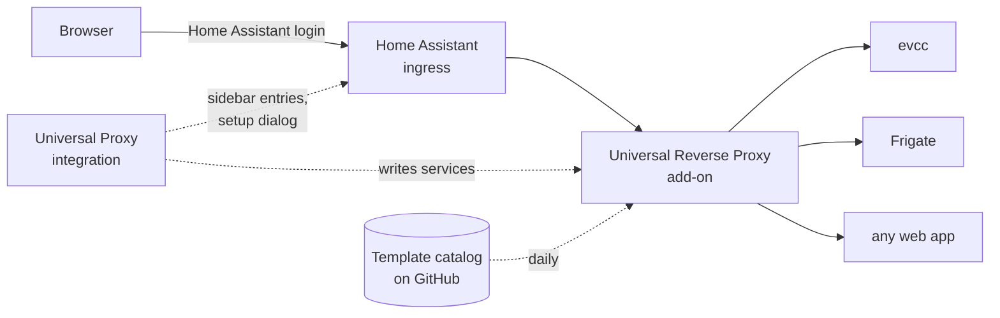
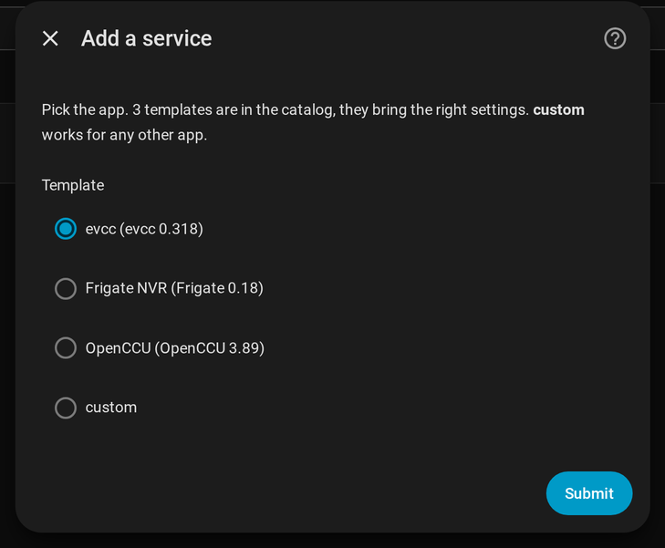
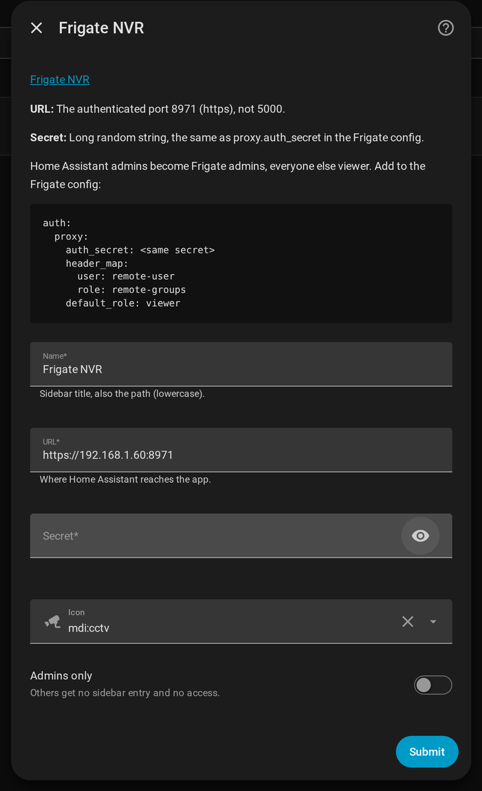

<p align="center"></p>

<p align="center"><b>All your self-hosted web apps in the Home Assistant sidebar, with one add-on.</b></p>

<p align="center">
<a href="https://github.com/hacs/integration"></a>

</p>

Instead of one proxy add-on per app (evcc proxy, Frigate proxy, OpenCCU proxy, …) you install this one and add your apps in a dialog. Each app gets its own sidebar entry and opens inside Home Assistant, also through Nabu Casa or your own reverse proxy.

- **One sidebar entry per app**, with its own name and icon
- **Set up in a dialog**: pick the app, fill in only what it needs
- **Templates** for apps that need more than a plain proxy, from a catalog that updates without new releases
- **Admins only** apps are hidden from other users and blocked for them
- **Users and roles** can be passed to the app (Frigate: Home Assistant admins become Frigate admins, everyone else viewer)

## How it works



You need **both parts**, both come from this repository:

| | What it does | Install from |
|---|---|---|
| **Universal Reverse Proxy** (add-on) | The proxy itself | Add-on store |
| **Universal Proxy** (integration) | Sidebar entries and setup dialog | [HACS](https://hacs.xyz) |

Needs Home Assistant OS or Supervised (for add-ons) and HACS.

## Install

### 1. Add-on

[](https://my.home-assistant.io/redirect/supervisor_addon/?addon=2e4b761a_universal_reverse_proxy&repository_url=https%3A%2F%2Fgithub.com%2Fpvillmann%2Fhassio-addon-universal-proxy)

The button adds this repository to the add-on store and opens the add-on. **Install** and **start** it. Nothing to configure here.

### 2. Integration

[](https://my.home-assistant.io/redirect/hacs_repository/?owner=pvillmann&repository=hassio-addon-universal-proxy&category=integration)

**Download** Universal Proxy in HACS and **restart** Home Assistant. Then add the integration, it finds the add-on by itself:

[](https://my.home-assistant.io/redirect/config_flow_start/?domain=universal_proxy)

### 3. Your apps

Settings → Devices & services → **Universal Proxy** → **Configure** → *Add a service*

1. Pick the app from the template catalog, or **custom** for any other web app.
2. Fill in the form. It asks only for what the app needs, usually the name and the address, and shows setup notes (for Frigate the config snippet).
3. Done: the add-on restarts and the app appears in the sidebar.

<table><tr>
<td valign="top"></td>
<td valign="top"></td>
</tr><tr>
<td>Pick the app from the catalog</td>
<td>The form asks only for what the app needs</td>
</tr></table>

*Edit a service* and *Remove a service* work the same way.

<details><summary>Manual install (without the buttons)</summary>

- Add-on: Settings → Add-ons → Add-on store → ⋮ → Repositories → add `https://github.com/pvillmann/hassio-addon-universal-proxy`, then install **Universal Reverse Proxy**.
- Integration: HACS → ⋮ → Custom repositories → add `https://github.com/pvillmann/hassio-addon-universal-proxy` as type **Integration**, download **Universal Proxy**, restart Home Assistant, then Settings → Devices & services → Add integration → Universal Proxy.
</details>

<details><summary>For YAML fans: configure the add-on directly</summary>

The dialog writes the add-on's configuration. You can also edit it yourself on the add-on's *Configuration* tab:

```yaml
services:
  - name: evcc
    template: evcc
    url: http://192.168.1.50:7070
  - name: Frigate
    template: frigate
    url: https://192.168.1.60:8971
    secret: <long random string>
  - name: Grafana
    url: http://192.168.1.70:3000
    icon: mdi:chart-line
```

All options: [DOCS.md](universal-reverse-proxy/DOCS.md).
</details>

## Templates

A template brings the right icon, admin default and setup notes for an app, and handles what it needs beyond a plain proxy: absolute links that break under a subpath, a login by header, a legacy charset. Apps without a template work as **custom**.

| App | Template does |
|---|---|
| [evcc](https://evcc.io) | Icon, works as is |
| [Frigate](https://frigate.video) | Home Assistant user and role → Frigate user and role, shared secret |
| [OpenCCU](https://github.com/OpenCCU/OpenCCU) | Rewrites the WebUI's absolute paths, fixes umlauts, admins only |

Templates live on the [`catalog` branch](../../tree/catalog). The add-on loads it at start and once a day, so new templates arrive without an update. Every template is checked before it is used: templates can only move paths and set a few allowed headers, they can't put scripts into pages.

**Your app is missing?** Every app is welcome, [request a template](../../issues/new?template=template-request.yml). Writing one yourself: format and rules are in the README of the catalog branch, pull requests go there.

## More

Security notes, all options and limits: [DOCS.md](universal-reverse-proxy/DOCS.md)
